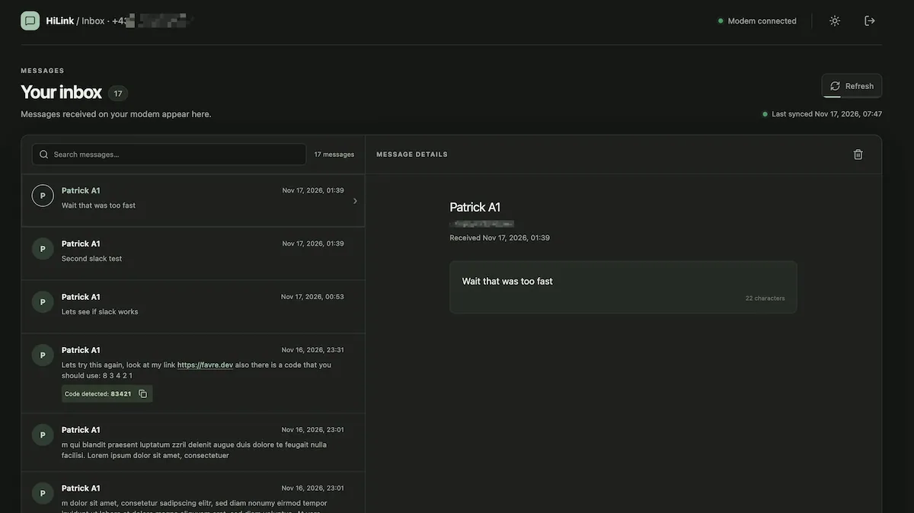

# HiLink SMS Inbox

A self-hosted web inbox for SMS received by a Huawei [HiLink](https://developer.huawei.com/consumer/cn/doc/3090501) modem. Read and search messages, copy detected verification codes, inspect sender reputation, and delete SMS from the modem. Optionally forward new messages to Slack.



The app runs in a single container with no database. Using Go, this requires > 15 MB RAM and hardly any CPU. Messages stay on the modem; the app keeps an in-memory copy. It cannot send SMS.

## Run with Docker Compose

You need Docker Compose, a reachable HiLink modem, and its administrator credentials.

1. Generate a bcrypt hash for your **web login** password using `htpasswd` (Apache utilities). This prompts for the password:

   ```sh
   htpasswd -nBC 12 admin | cut -d: -f2
   ```

2. Create a `.env` file in the repository root:

   ```dotenv
   HILINK_URL=http://192.168.8.1
   HILINK_USERNAME=admin
   HILINK_PASSWORD='your-modem-password'
   AUTH_USERNAME=admin
   AUTH_PASSWORD_HASH='paste-the-bcrypt-hash-here'
   ```

   Keep the hash in single quotes so Compose preserves its `$` characters. Protect this file with `chmod 600 .env` and do not commit it. Web login credentials are separate from modem credentials.

3. From the repository root, build and start the app using [the example Compose file](doc/example.compose.yaml):

   ```sh
   docker compose --env-file .env -f doc/example.compose.yaml up -d --build
   ```

4. Open <http://localhost:8080> and sign in with your web login credentials.

The supplied Compose file listens only on loopback. For remote access, put it behind an HTTPS reverse proxy and set `TRUSTED_PROXY` to the proxy's source CIDR. The app serves HTTP internally and ignores forwarded headers from untrusted peers.

## Using the inbox

- Select a message to read it and mark it read on the modem. HiLink does not support marking it unread again.
- Search by sender number or message text. Use the copy button for detected verification codes; detection can mistake other numbers for codes.
- Delete a message to **permanently remove it from the modem**, freeing SMS storage.
- Switch between light and dark themes; your browser remembers the choice.

The inbox syncs automatically, every 30 seconds by default. If the modem is unreachable, the app keeps the last successful snapshot. Restarting the app clears its cache and signs you out; messages remain on the modem.

### Slack forwarding

Set `SLACK_ENABLED=true` and `SLACK_WEBHOOK_URL` to an HTTPS Slack incoming webhook in `.env`, then recreate the container:

```sh
docker compose --env-file .env -f doc/example.compose.yaml up -d
```

Only messages arriving after the startup sync are forwarded. Existing messages are not sent to Slack. Delivery is best-effort, with no durable retry queue.

## Configuration

All settings use environment variables. The four credentials in the setup example are required; other settings are optional.

| Variable | Default | Purpose |
| --- | --- | --- |
| `HILINK_URL` | `http://192.168.8.1` | Modem address |
| `HILINK_USERNAME` | — | Modem administrator username |
| `HILINK_PASSWORD` | — | Modem administrator password |
| `AUTH_USERNAME` | — | Web login username |
| `AUTH_PASSWORD_HASH` | — | bcrypt hash of the web login password |
| `ADDRESS_BOOK` | — | Contact names, e.g. `+15550100:Alex\|+15550101:Sam` |
| `POLL_INTERVAL` | `15s` | Modem sync and Slack detection run every **2 ×** this value |
| `SESSION_TTL` | `12h` | Web login session lifetime |
| `SLACK_ENABLED` | `false` | Enable Slack forwarding |
| `SLACK_WEBHOOK_URL` | — | Required when Slack is enabled |
| `PUBLIC_URL` | `https://sms.favho.me` | Base URL for direct Slack links to individual messages |
| `LISTEN_ADDR` | `:8080` | HTTP listen address |
| `TRUSTED_PROXY` | — | Comma-separated proxy CIDRs allowed to assert HTTPS and forwarded host |

To use `ADDRESS_BOOK` or `SESSION_TTL` with the supplied Compose file, add them to the service's `environment` section. `LISTEN_ADDR` is fixed to `:8080` there.

## Modem compatibility and troubleshooting

Verified on a **Huawei E8372**, Web UI **17.100.19.00.1217**: login, message retrieval, and marking messages read. Deletion on physical hardware and E353/E3131 compatibility remain unverified. Other firmware may behave differently.

- **Login error `108006`:** the modem rejected the credentials. This E8372 Web UI truncates passwords to 15 characters; configure the actual password accepted by the modem, not a longer pasted value. The app sends `HILINK_PASSWORD` unchanged.
- **Lockout error `108007`:** stop retrying and check the credentials and firmware's password limit.
- **Development config changes not taking effect:** restart `pnpm dev` after editing `.env.dev`; hot reload does not reload environment variables.

## Development

Requires Go 1.27.3+, Node.js 26+, and pnpm 12.5.

```sh
pnpm install
cd backend && go mod download && cd ..
pnpm dev
```

On first run, this creates `.env.dev` from [.env.dev.example](.env.dev.example). It starts a mock modem, the Go backend with hot reload, and Vite. Open <http://localhost:5173> and sign in with `admin` / `admin` when using the example defaults. To use a real modem, update the `HILINK_*` values in `.env.dev` and restart.

The mock inbox starts empty. Add a message:

```sh
curl -X POST http://127.0.0.1:18080/__mock/messages \
  -H 'Content-Type: application/json' \
  -d '{"sender":"+1 555 0100","text":"Your verification code is 482913."}'
```

It appears after the next poll. Mock messages are held in memory and lost on restart.

Use `pnpm build` to compile the frontend and `dist/hilink-sms`. Run the quality checks with:

```sh
pnpm lint && pnpm fmt:check && pnpm typecheck && pnpm test && pnpm build
```

Browser tests: `pnpm test:e2e`.
